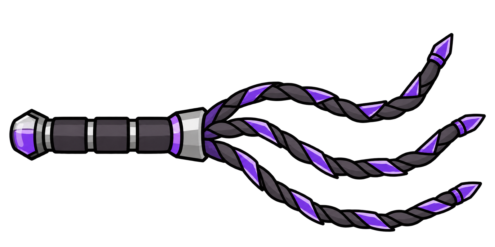
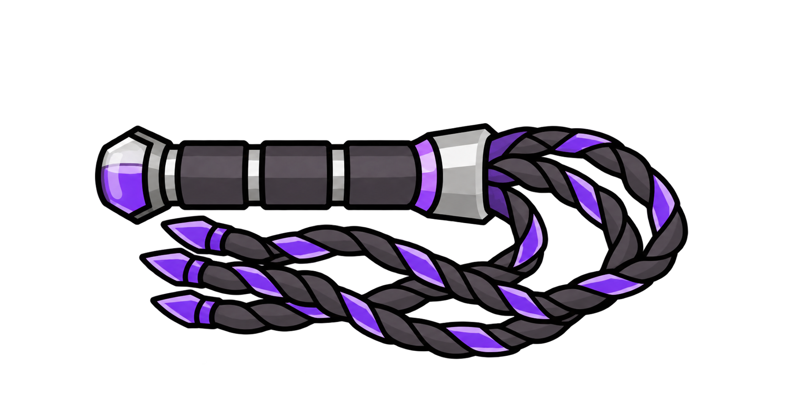
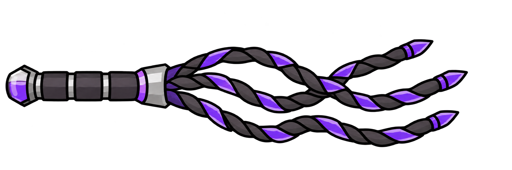
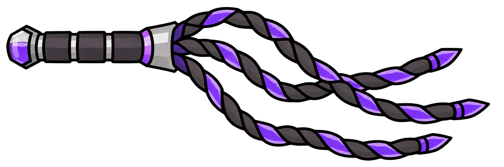

# SSC 短鞭多姿态原稿选定记录

日期：2026-10-19。状态：物品、待机、抽击与回落四张高清原稿已获维护者认可并保存；四图已完成 256×256 导出与柄部标定对齐，已接入物品图与手持姿态切换，已获本轮实机认可，见[实现记录](../Development/Completed/SSC短鞭四姿态接入与测试.md)。旧单图的实机确认保留原范围。

[美术索引](README.md) · [武器资源表](SSC纳米催情液武器资源.md) · [工业武器规划](../Design/SSC工业时代纳米催情液武器开发规划.md)

## 当前选定的四张图

下表为本次明确选定版本，均由内置 imagegen 生成，原样复制入仓库，保留透明 RGBA 高清原稿。物品／待机为 1774×887，抽击／回落为 2172×724，均为 RGBA，alpha 范围 0～255。原稿原样保留；统一画布及柄部标定后的派生贴图见下方“256×256 导出版本”，本表仍指高清源图。

| 用途 | 仓库原稿 | 原始生成文件名 | 选定依据 |
| --- | --- | --- | --- |
| 物品图：拟用于地面、库存、信息卡 | [SSC_PnaShortWhip_Item_Approved.png](SSC_PnaShortWhip/SSC_PnaShortWhip_Item_Approved.png) | `exec-d7621759-7daf-4e52-92ab-bb0bfc010e8f.png` | 维护者在该图后确认“可以，接着绘制待机图”；柄尾在左，三股独立鞭束向右弯放、末端错开 |
| 待机图：拟用于手持非抽击状态 | [SSC_PnaShortWhip_Idle_Approved.png](SSC_PnaShortWhip/SSC_PnaShortWhip_Idle_Approved.png) | `exec-757d1a74-50ae-436c-8a7e-b64bf3525cc5.png` | 维护者确认“第二版这柄尾在左的好”；柄尾在左、束根在右，三股鞭束折回柄尾方向，并在握柄下方交织重叠 |
| 抽击图：拟用于鞭束实际出手阶段 | [SSC_PnaShortWhip_Attack_Approved.png](SSC_PnaShortWhip/SSC_PnaShortWhip_Attack_Approved.png) | `exec-64bd2382-46de-4b95-a802-1dc5007f2ab8.png` | 维护者在缩短版后确认“这版可以，然后绘制回落态”；柄尾在左，三股鞭束向右展开并保留弯曲和交叠 |
| 回落图：拟用于抽击后恢复阶段 | [SSC_PnaShortWhip_Recovery_Approved.png](SSC_PnaShortWhip/SSC_PnaShortWhip_Recovery_Approved.png) | `exec-e2027163-803d-4eb9-af25-260d312b597b.png` | 维护者最终明确指定“还是用这版吧”；采用该图原有的弯垂轮廓与细节，不选后续放大回弯或重绘版本 |

物品图 SHA-256：`b3340419cab16291fe6d2bd4275b988e60d3df8ed9cd0baf9c18967c10e87c55`。

待机图 SHA-256：`e03309d810569fc1d3248a774096344e88b80ca05df9a134ef04f57704073bc7`。

抽击图 SHA-256：`8afc9fe5c66c224c9b6a6eaf97bc9ee3330942620aab8ad751f7a8d683d0fa33`。

回落图 SHA-256：`082e755d0d1466f5abc6b062519c9ae17b61490fcb64532e83cfb34ac0fd2203`。

原始生成目录为 `C:/Users/24196/.codex/generated_images/01a14d5a-bbd6-79f3-9356-75f2d8ad5113/`，原文件保留；仓库副本不依赖该本机目录即可使用。

### 物品图预览

### 待机图预览

### 抽击图预览

### 回落图预览

## 256×256 导出版本

2026-10-19 已将四张选定原稿分别导出为真实 256×256 RGBA 透明画布；运行资源已采用这组导出并增加手持姿态切换，维护者认可最终效果后授权提交，实机状态见实现记录。高清原稿不改动。

| 姿态 | 导出贴图 | 柄尾至束根标定长度 | 柄轴中心坐标 |
| --- | --- | --- | --- |
| 物品 | [SSC_PnaShortWhip_Item.png](SSC_PnaShortWhip/256/SSC_PnaShortWhip_Item.png) | 80.15 px | (50.30, 128.00) |
| 待机 | [SSC_PnaShortWhip_Idle.png](SSC_PnaShortWhip/256/SSC_PnaShortWhip_Idle.png) | 80.09 px | (50.23, 127.84) |
| 挥击／抽击 | [SSC_PnaShortWhip_Attack.png](SSC_PnaShortWhip/256/SSC_PnaShortWhip_Attack.png) | 80.11 px | (50.28, 127.55) |
| 回落 | [SSC_PnaShortWhip_Recovery.png](SSC_PnaShortWhip/256/SSC_PnaShortWhip_Recovery.png) | 79.90 px | (50.17, 128.25) |

以各原稿的柄尾左端、银灰束根口及柄轴为标定点，对整张姿态作等比缩放和平移：目标柄长 80 px、标定柄轴中心 (50,128)，未单独拉伸或替换握柄。栅格尺寸和放置位置四舍五入，四图标定柄长差小于 0.3 px，中心偏差小于 0.5 px；原稿中握柄的造型差异保留，并非像素完全相同的柄部。

四图都采用相同布局基准，因此待机图的轮廓自然集中在画布左侧，不按各自外轮廓重新居中放大。这样可避免为了填满待机画布而使柄部突然变大；后续接入绘制时还需按统一锚点处理实际握持位置，当前画布的几何中心不是握柄中心。

导出按 alpha>1 的可见边界加两源像素留边，忽略极低透明孤立像素对排版的影响，保留裁切内部原 alpha；使用预乘 alpha 的 Lanczos 缩小以减少暗边，不重绘、不旋转、不锐化、不改色。各图完整落入画布，可见轮廓不接触边缘，四角透明，alpha 范围均为 0～255。

可复现脚本：[Export-256.py](SSC_PnaShortWhip/Export-256.py)（依赖 Pillow）；源哈希、标定点、裁切范围、比例、位移及输出 SHA-256 见[export.json](SSC_PnaShortWhip/256/export.json)。脚本对选定原稿哈希作校验，避免误用后续试稿。

## 设计要求与生成过程

保留同柄连接三股独立编织短鞭束的构造、深灰分段握柄、银灰束根、紫色金属刃片，以及显示紫色液面的透明储液柄尾。采用粗黑描边、简洁平涂与有限高光；储液柄尾仅为静态美术，不新增运行耗液管理。

物品图以此前已接入短鞭的高清原图 `exec-28c3fe14-a0d2-4bf7-bf78-13b58308e48a.png` 为参考，主要提示为保持握柄和画风，让三股鞭束自然弯放，呈现柔软的编织束与分段刃片。

待机图最终重绘使用已认可的物品图作参考。维护者纠正要求为：三股鞭束接近等长；大致重力方向朝柄尾；明显回垂；允许相互交织重叠。最终提示明确柄尾在左、束根在右，鞭束在束根附近平滑折回，主要长度沿柄尾方向垂落，末端集中在相近的左向范围；各股独立编织，可交叠但不合并成一股。

未选用的待机试稿：`exec-93825d49-3213-45e0-a5cc-6de1ecf2c8f7.png`（末端明显错开，回垂方向不足）及 `exec-ff2c871d-fd02-49b2-8936-4d93cb0a6a23.png`（柄尾在右，方向不符）。它们不属于选定原稿；“第二版”明确指本页选定的 `exec-757d1a74-50ae-436c-8a7e-b64bf3525cc5.png`。

抽击图以物品与待机原稿为参考；首稿 `exec-f317cdb9-4d97-4d07-8608-ab1a2608b84f.png` 因鞭束偏长未选用。按要求保持握柄、缩短三股鞭束后生成当前选定的 `exec-64bd2382-46de-4b95-a802-1dc5007f2ab8.png`。

回落图经历多次重绘，维护者最终回选 `exec-e2027163-803d-4eb9-af25-260d312b597b.png`：该图直接以认可的抽击图为参考，主要要求保留编织、紫色刃片和尖头细节，改变弯垂姿态。`exec-344995a4-a3a8-48e3-81b7-b1385b4b9c63.png`、`exec-46188754-0188-4f67-a2fe-72c87f046b6b.png`、`exec-c28098aa-61d0-45aa-8d5b-282bd4611fc8.png`、`exec-76bd6400-eab6-4f02-bf8d-b4a5306972f2.png` 均不作为当前回落定稿；后续不得因生成时间更晚而替换本页选定图。

export.json 中 `runtime_integrated=false` 保留导出时的状态；当前运行接入及同步结果见实现记录，不回写这份导出来源元数据。

当前握持修正：待机绕标定柄心调整为柄尾朝下斜 45°，挥击／回落继续原版攻击方向；纹理不重新生成，具体触发与测试见实现记录。

## 后续边界

四种姿态的高清原稿与 256×256 对齐导出版本均已齐备；原稿选定批次已提交，本轮导出及运行接入已获实机认可，按授权提交。已增加多姿态 C# 并将专用鞭击 XML 接入，已同步本机游戏，后续验收以实现记录为准；手持时仍须结合原版旋转、翻面核对实际握持位置与回垂方向。

本轮核对四份原稿哈希未变、四份输出的尺寸／透明通道、柄部标定误差、轮廓边距、脚本可复现性与文档引用。此前导出批次只处理资源；当前接入批次的测试、构建和同步另见实现记录，设计认可不替代实机验收，数值、版本与冻结基线不改动。
