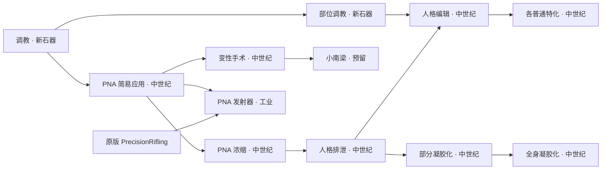

# 低科技适配分析与开发规划

记录日期：2026-10-17。
最近更新：2026-10-18（确认配方名称、10→1／600 参数及模组灶台接入策略）。
状态：**首批已实现并编译，待维护者实机确认。** 承接[总体规划第 24 项](未来内容开发规划.md#24-中世纪及更低技术水平下的内容可用性待设计)。

分析基线：SSC 2.4.2 的 1.7 定义与源码；原版机制核对本机 **1.7.4981 rev136**。1.6 与 Common 保留 2.4.1 冻结内容。首批实现与验证见[实现记录](../Development/Verification/低科技适配首批实现与测试.md)，不表示具体封顶模组已获实机确认，也不指定下一个发布版本。

## 1. 已确认的设计原则

维护者倾向：**不与工业时代有明确关联的技术，都可以下放到工业时代之前。** 对 PNA、人格凝胶等现成特殊材料，进一步确认采用：**使用可下放，工业加工保留门槛。**

判断等级时，看角色需要掌握的操作，而非效果是否超常：

- 徒手训练、经验传授、引导体内已有微械、使用成品药液、手工塑造现成人格凝胶，不因涉及“纳米”“人格”或身体变形而自动要求工业科技。
- 明确依赖精密枪械制造、工业工作台或工业加工流程的生产技术，保留相应等级和工艺条件。
- 使用工业药品和浓缩 PNA，不等于掌握它们的制造技术。研究可以提前学会，执行仍消耗真实材料；目标玩法禁止这些材料时，相应操作仍不能完成。
- 保留已有技能、身份、身体状态、培养完成度、材料数量和风险。低科技适配不等于所有成长、终极成果和改造立即可得。

维护者进一步明确：**PNA 浓缩也下放到 Medieval，保留“PNA 简易应用 → PNA 浓缩 → 人格排泄 → 人格编辑”的统一发展线。** 人格排泄实际消耗浓缩 PNA，研究顺序继续体现这一材料与技术关系；不再采用此前拆开人格排泄、人格编辑前置的建议。浓缩生产的低科技工作台入口也纳入首轮范围，不能只改研究标签。

制作入口进一步明确为：**篝火／灶台新增“粗放浓缩紫色纳米催情液”配方，以更高原料损耗制成同一种浓缩 PNA；药物台保留高效减压浓缩。** 下文 维护者已确认首版为 10→1、基础工作量 600；尚未完成实现与实机验收。

这比原第 24 项仅优先讨论普通培养的范围更宽：**人格提取、凝胶手工处理、凝胶化手术也按同一标准审查，不预设必须留在太空或超凡时代。**

## 2. 当前结构与机制事实

实施前两版研究 XML 相同，共 18 项：14 项 Industrial、2 项 Spacer、2 项 Ultra。2026-10-18 首批将[1.7 研究定义](../../1.7/Defs/ResearchDefs/ResearchProjectDef.xml)改为 2 项 Neolithic、15 项 Medieval、1 项 Industrial；1.6 保持原冻结内容。全部 SSC 研究均未显式指定研究台或研究设施。

现有依赖是：普通特化 → 人格编辑 → 人格排泄 → PNA 浓缩 → PNA 简易应用 → 调教。“人格编辑”还同时要求“部位调教”。维护者要求保留这条发展线，因此应将相关上游研究一起下放，并解决浓缩工作台的工业限制，不通过拆除前置绕开它。

本机 `ResearchProjectDef.CostFactor`、`CanStartNow`、`CanBeResearchedAt` 与蓝图逻辑已通过目标 DLL 核对：

| 条件 | 实际作用 | 本项处理 |
| --- | --- | --- |
| `techLevel` | 跨时代研究成本、研究界面等；原版没有单凭等级禁止玩家研究的科技上限 | 修正等级；封顶模组如何隐藏、禁用或删除研究，另行验证 |
| `baseCost` | 基础研究量 | 首轮保留全部现有点数，不同时做整树降费 |
| `prerequisites` | 上游研究必须完成 | 保留现有统一发展线，通过整链降级消除工业前不可研发的上游 |
| 研究台／设施字段 | 实际可用研究台与设施 | 核对合并 Def；降等级不会自动解除这些要求 |
| 蓝图要求与来源 | 能否开始研发、能否取得蓝图 | 基础调教沿用已有主人入口与蓝图规则 |
| 配方／工作台／耗材 | 研究完成后能否实际执行 | 分清成品使用与材料自产 |

原版跨时代成本按研究等级最多计算到 `Industrial`，每落后一级增加 50%。部落研究相同基础点数时，`Industrial` 为 ×2，`Medieval` 为 ×1.5，`Neolithic` 为 ×1；工业派系研究这三档均为 ×1。因此保留 `baseCost` 也会自然减轻部落开局的跨时代惩罚。实际耗时仍受研究员、研究台等影响。

降级不会自动改变蓝图数量、市场价或持有派系。当前基础调教在 Royalty 环境仍需一张蓝图，来源类别为 `Empire`／`Outlander`；使用主人资格道具可以补齐蓝图，但不会直接完成研究。

## 3. 18 项研究的首批分级

直接训练设为 `Neolithic`；系统性培养、成品药剂操作和特殊材料处理先统一设为 `Medieval`。这是首轮分档建议，不表示相关手法在现实历史上对应同一时代。

| 研究／defName | 实施前等级／点数 | 首批等级 | 判断与实施要点 |
| --- | --- | --- | --- |
| 调教 `SSC_RES_BasicTraining` | Industrial／500 | **Neolithic** | 典籍、传授与基础实践；保留主人资格与 Royalty 蓝图规则 |
| 部位调教 `SSC_RES_BodyPartTraining` | Industrial／800 | **Neolithic** | 直接训练和身体反馈，无工业设备要求；保留基础调教前置 |
| PNA 简易应用 `SSC_RES_PNASimpleApp` | Industrial／800 | **Medieval** | 操作现成药液，不要求制造微械；当前只承担研究树前置，不能宣称描述功能已全部接通 |
| 变性手术 `SSC_RES_SexChange` | Industrial／1000 | **Medieval** | 现成 PNA 驱动器官改造；配方与研究脱节问题见第 5 节 |
| 小南梁 `SSC_RES_Femboy` | Industrial／1200 | **Medieval，预留节点** | 缺少完整玩法，也没有明确工业工艺依据；降级不代表完成开发 |
| PNA 简易发射器 `SSC_RES_PNASimpleLauncher` | Industrial／1000 | **Industrial** | 明确枪械制造链；保留精密步枪研究、机械加工台和工业零件 |
| PNA 浓缩 `SSC_RES_PNAConcentration` | Spacer／1200 | **Medieval（维护者明确）** | 保留 PNA 简易应用前置；解锁篝火／灶台粗放浓缩紫色纳米催情液，药物台继续使用高效配方 |
| 人格排泄 `SSC_RES_PE` | Spacer／1500 | **Medieval** | 实际使用浓缩 PNA；保留浓缩研究前置，继续体现材料应用的发展关系 |
| 人格编辑 `SSC_RES_SlaveSpecialization` | Industrial／1500 | **Medieval** | 保留部位调教、人格排泄两个前置，与人格排泄处于统一发展线上 |
| 奶牛化 `SSC_RES_CowTraining` | Industrial／1200 | **Medieval** | 培养与已有身体状态的利用，无工业制造环节 |
| 公共车 `SSC_RES_PublicUse` | Industrial／1200 | **Medieval** | 社交与行为培养；显示名称不是现代车辆制造技术 |
| 训导官 `SSC_RES_TrainerOfficer` | Industrial／1200 | **Medieval** | 系统性训练与职责培养；保留当前身份、绑定和阶段条件 |
| 宠物猫 `SSC_RES_PetCat` | Industrial／1200 | **Medieval** | 培养与互动，无工业制造环节 |
| 战斗员 `SSC_RES_Combatant` | Industrial／1200 | **Medieval** | 训练、作战引导已有微械改造身体；不要求制造微械，不因神经强化另加工业前置 |
| 宠物狗 `SSC_RES_PetDog` | Industrial／1500 | **Medieval** | 培养、动物训练与互动；首轮保留猫→狗的顺序 |
| 宠物兔 `SSC_RES_PetRabbit` | Industrial／1800 | **Medieval，预留节点** | 入口仍禁用，医疗／家务重设计归第 18 项；降级不恢复旧功能 |
| 部分凝胶化 `SSC_RES_GelatinizationPartial` | Ultra／2000 | **Medieval** | 使用成品药物诱发身体适应；保留工业药品、医疗技能和失败风险 |
| 全身凝胶化 `SSC_RES_GelatinizationFull` | Ultra／3000 | **Medieval** | 同样按材料操作处理；保留部分凝胶化前置、已排泄身体、技能、耗材与风险 |

修订结果为 **2 项 Neolithic、15 项 Medieval、1 项 Industrial**，工业研究仅保留 PNA 简易发射器。小南梁、兔仍是预留或未开放内容，不能把 17 项等级下放写成新增 17 项可玩功能。

人格排泄和凝胶化降级，依据是当前操作与设备条件；不为此补写紫色微械的起源或制造原理。

## 4. 保留统一研究发展线

**撤回此前两处前置拆分建议，保留现有研究依赖：**

1. `SSC_RES_PE` 继续前置 `SSC_RES_PNAConcentration`。
2. `SSC_RES_SlaveSpecialization` 继续前置 `SSC_RES_PE` 和 `SSC_RES_BodyPartTraining`。

这条研究链整体降为工业前，不为提前开放普通特化而单独拆出另一条培养线。研究完成不要求先实际进行一次人格提取手术；具体配方与身体条件仍分别检查。

图中普通特化仍保留猫→狗→兔依赖；不在本轮将全部节点改成并列。全身凝胶化另要求具体身体已完成人格排泄，研究完成不代替身体条件。

保留研究点数与 DefName，布局仅在连线冲突或难读时调整。新顺序对旧档的表现须实测；不重置已有研究进度、培养成果或人格记录。

## 5. 研究可学会之后，实际能做什么

### 5.1 普通培养与成品操作

取得主人资格、完成必要研究后，基础调教、部位开发和已开放的普通特化，可通过整条工业前研究线推进。普通特化继续要求人格编辑及其上游研究；PNA 浓缩通过低科技制作入口形成供应，不依赖先进入工业时代。战斗员不要求先制造枪械。奶牛泌乳、训导官阶段、宠物互斥、任务执行和经验来源仍按原规则。

| 操作 | 当前实际条件 | 低科技范围 |
| --- | --- | --- |
| 主人资格道具 | [欲望之种](../../1.7/Defs/ThingsDefs/SSC_MasterQualificationItem.xml)为 Spacer 物品；免费领取任务、使用代码未按玩家科技等级拒绝 | 保留超凡造物身份和既有入口；封顶模组若删除该物品，另作兼容 |
| 人格排泄 | [配方](../../1.7/Defs/RecipeDefs/RecipeDef_Surgery_PE.xml)：Medicine 类别药物 ×5、浓缩 PNA ×15、对应研究 | 浓缩品可由新增的低科技制作入口供应；保留真实原料、药品消耗，不要求外来浓缩成品作为常规起步条件 |
| 凝胶终极加工 | [各方向配方](../../1.7/Defs/RecipeDefs/RecipeDef_PSEdit.xml)：雕刻台、方向研究、培养完成的凝胶 | 属于手工处理，不额外补高科技研究锁；保留完成度、互斥与实际植入条件 |
| 人格植入 | [目标检查](../../Sexslavecraft/common/WorkGiverTargetUtility.cs)与[执行驱动](../../Sexslavecraft/JobDriver/JobDriver_InsertPersonality.cs)：空壳、分配凝胶、可达、预约与接触操作 | 现无独立工业设备、药品、技能或研究要求；不把降级描述成新增植入功能 |
| 部分凝胶化 | [配方](../../1.7/Defs/RecipeDefs/Recipe_Gelatinization.xml)：医疗 5、工业药品 ×1、对应研究 | 研究可提前完成；手术仍须取得药品并承担现有风险 |
| 全身凝胶化 | 同文件：医疗 10、工业药品 ×4、浓缩 PNA ×10、对应研究；代码检查已排泄身体 | 研究可提前完成；耗材、身体与风险条件保留 |

[部分凝胶化](../../Sexslavecraft/Recipe/Recipe_ApplyGelatinization.cs)和[全身凝胶化](../../Sexslavecraft/Recipe/Recipe_ApplyFullGelatinization.cs)代码执行手术判断并添加临时 Hediff，后续由身体适应组件推进；没有发现专用工业设备要求。因此不能只凭工业药品这一成品耗材，就把手术知识判为 Ultra。

本机原版雕刻台、简单研究台均无电力组件和建造研究要求，但仍有钢材等成本。“无电力要求”也不等于在禁止金属的玩法中必然可建造。

### 5.2 PNA 浓缩生产适配与保留的工业加工

#### 5.2.1 篝火／灶台的粗放浓缩紫色纳米催情液

现有两份[高效配方](../../1.7/Defs/RecipeDefs/RecipeDef_PNA_PLUS.xml)仍仅在 `DrugLab` 执行；原版该台需要 `DrugProduction` 和 6 个工业零件，但没有电力组件。采用**独立新增粗放配方**解决低科技入口，撤回此前直接将高效配方扩展到低科技工作台的建议。

设定表达：药物台用减压蒸发尽量保留活性微械；粗放法直接加热蒸去多余液体，部分微械因高温失活或随残渣损失。通过投入更多原液，最终制成相同规格的浓缩品。两条工艺在描述中分别说明，不把现有减压工艺改写成普通煮沸，也不另造一种弱效浓缩品。

已确认的首版参数与保留的药物台参数：

| 配方 | 工作入口 | 原液 → 浓缩品 | 基础工作量 | 工作技能／速度 |
| --- | --- | --- | --- | --- |
| **粗放浓缩紫色纳米催情液（新增）** | `Campfire`、`FueledStove`、`ElectricStove` | **10 → 1** | **600，已确认** | Cooking／CookSpeed |
| 浓缩紫色纳米催情液（现有，调整显示名） | `DrugLab` | 5 → 1 | 450，保持 | Intellectual／DrugSynthesisSpeed |
| 批量浓缩紫色纳米催情液（现有，调整显示名） | `DrugLab` | 20 → 4 | 1350，保持 | Intellectual／DrugSynthesisSpeed |

粗放法相对药物台**每份消耗翻倍、原料利用效率为 50%**，不是产物药效减半，也不是宣称原料实际含量损失了某个测量百分比。首版采用确定性配方，不叠加随机失败、废品、额外成瘾或新浓缩品状态。

工作量确定为 600，比药物台单份增加约三分之一，将主要代价放在原料损耗。本机原版篝火已有 `WorkTableWorkSpeedFactor=0.5`；篝火实际加工还会更慢，不再另加篝火专用配方倍率。灶台仍受自身工作台、房间、角色烹饪速度等条件影响，不把基础工作量直接当作固定耗时。高烹饪技能提高工作速度，不提高 10→1 的产出率，也不另设最低烹饪等级。

具体实施边界：

- 新增独立 `RecipeDef`，DefName 为 `SSC_Make_SuperDrug_Rough`；研究前置仍为 `SSC_RES_PNAConcentration`，随该研究下放 Medieval。篝火本身无科技门槛，不代表开局未研究即可粗放浓缩紫色纳米催情液。
- 原料仅接受 `Purple_Aphrodisiac_Nanofluid`，产物仍为 `Purple_Aphrodisiac_Nanofluid_Plus`；材料数量、固定筛选和默认筛选保持一致，不允许用浓缩品作为本配方原料。
- 显式使用 Cooking 工作与 `CookSpeed`，并按原版烹饪配方设置 `requiredGiverWorkType=Cooking`；由开启烹饪工作的角色执行，避免在灶台上继承药物台的智识工作路线。
- 复用原版烹饪工作表现与配方排程，但不继承食物配方父级的营养、食材分类或餐食产物设置；这是制药产物，不通过改餐食规则实现。
- `recipeUsers` 显式列明三个原版工作台。定义加载结束后，扫描继承 `Building_WorkTable` 且最终 `AllRecipes` 包含原版 `CookMealSimple` 或 `CookMealSimpleBulk` 的建筑，追加粗放配方的使用者并同步已生成的配方缓存。覆盖从建筑 `recipes`、配方 `recipeUsers` 和 XML 继承获得原版烹饪能力的模组灶台；按 Def 引用判定，不匹配名称或显示文本。篝火、燃料灶提供低科技入口，电灶沿用其供电规则。
- 自动接入只追加粗放配方，保留其他模组的配方顺序与内容，重复执行不重复添加。药物台、屠宰台、仅供暖建筑等没有上述烹饪能力的对象不自动获得配方。仅支持自定义食谱的专用炉具可由兼容补丁显式加入新配方的 `recipeUsers`；不宣称自动覆盖所有模组建筑。
- 篝火／燃料灶沿用原版燃料规则，电灶沿用原版供电规则；配方不重复收取木材或另设电力费用。缺燃料、断电和工作中断的可执行性与恢复须实测，不新增自定义燃料系统。
- 原有药物台配方只将显示名改为“浓缩紫色纳米催情液”“批量浓缩紫色纳米催情液”，原料比例、工作量、技能、描述与入口保持，工业设备的价值体现为更高回收效率及既有批量优势。不将原有 5→1 或 20→4 配方同时开放给篝火／灶台。
- 首轮新增一个单份粗放配方；可使用原版“做 X 次／做到 X 个”的排程。更大量粗放配方待实际使用频率再评估，不预先增加一组新配方。

材料成本例：一次人格排泄需要 15 份浓缩品，粗放法消耗 **150 份原液**，药物台法为 **75 份**；全身凝胶化另需 10 份浓缩品，对应粗放法 **100 份原液**。药品等其他耗材不变。后续据实际原液产出和研究节奏观察 10→1 是否合适，不把尚未测量的供应速度写成已平衡。

#### 5.2.2 保留的工业加工

- **发射器制造：** [武器](../../1.7/Defs/ThingsDefs/SSC_Gun.xml)继承机械加工台配方，消耗工业零件，研究含 `PrecisionRifling`。保留生产条件；现成武器能否使用由原有装备规则和目标模组决定。
- **两套服装制造：** [简易维持装置](../../1.7/Defs/ThingsDefs/SexSlaveCloth.xml)和[战衣](../../1.7/Defs/ThingsDefs/SexSlave_EvilFallOutfit.xml)消耗工业／高级零件，使用电动裁缝台，首轮保留。原版该台断电仍能低速工作，不将供电列为绝对硬门槛。无零件的手工服装属于另一个配方设计任务。

### 5.3 同时发现的研究与功能不一致

- `SSC_RES_PNASimpleApp` 当前只承担下游研究前置，未找到直接检查它的配方或 C# 功能入口。降级不代表描述中的操作已全部接通。
- “变性手术”研究描述仍写“未开发”，但[实际手术](../../1.7/Defs/RecipeDefs/RecipeDef_Surgery_DCMtF.xml)已有 XML 与 C#，要求 Medicine 类别药物、PNA 原液和医疗 5，**没有研究前置**。调整研究等级不会改变当前手术可用性。
- 小南梁缺少完整玩法，兔仍禁用；本项不恢复或重做这两条玩法。

变性手术是否补接研究、PNA 简易应用是否接入具体功能，应作为单独的明确行为变更处理。首批不顺手加锁或删除配方，避免把科技整理扩展成未讨论的手术重构。

## 6. 开发批次与边界

**第一批：等级和浓缩入口。** 修改 1.7 研究定义，采用第 3 节分级，保留第 4 节既有研究依赖；按第 5.2.1 节在篝火／灶台新增独立的高损耗粗放浓缩紫色纳米催情液配方，不扩展两份高效药物台配方的入口。保留基础点数和已有 DefName。同步新配方与确有变化的描述、四语和现有源码镜像，不凭空创建不存在的源 Def 镜像。暂不新增模式开关、替代科技树或额外研究节点。保留人格编辑与人格排泄的统一发展定位，不再以拆分培养线为由重命名该研究。

**第二批：实际路径。** 走通“原液取得 → 低科技浓缩 → 人格排泄 → 人格编辑研究 → 普通特化”的研究与材料流程，另验证凝胶手工加工、植入与凝胶化。研究步骤与实际操作分别记录，不要求研究解锁前先执行提取手术。保留技能、材料、完成度、身体状态与风险；凝胶化所需工业药品仍是独立来源门槛。主人资格和蓝图优先使用已有免费领取路径，不先重做种子产出。

**第三批：目标玩法兼容。** 指定封顶模组后，再检查研究／物品／任务／建筑的实际过滤规则和合并 Def，针对真实阻断点补兼容。当前尚未指定具体模组，通用调整不能宣称适配全部低科技环境。

| 目标环境 | 首轮可承诺的范围 |
| --- | --- |
| 中世纪封顶，允许取得高科技成品 | 统一研究线、浓缩自产和普通培养适配；凝胶化等仍需独立验证工业药品来源 |
| 只允许 Neolithic 研究 | 基础调教和部位调教两个研究符合等级上限；不承诺全部特化／手术可研发 |
| 连高科技物品和材料也禁止 | 核对普通／浓缩 PNA、种子是否被过滤；允许 PNA 时应能低科技浓缩，不再把浓缩品必然视为外来高科技材料；工业药品仍单独核查 |

低科技浓缩已纳入首轮。无零件服装、额外的原液／工业药品来源、全部玩法下放到 Neolithic，不属于首轮建议范围。玩家说明须区分“可以研发”“已有成品时可以操作”和“可以自行生产”。

## 7. 验证与验收

| 层次 | 必查内容 |
| --- | --- |
| 静态结构 | XML 解析、18 项计数与分档、前置引用和环；已下放研究无工业研究作为必经祖先 |
| 范围与资源 | 只改 1.7 所需文件，1.6/Common 哈希不变；DefName、基础点数、四语与镜像一致 |
| 当前游戏加载 | 最终合并研究等级、前置、配方、蓝图、研究界面与错误日志；不以原始 XML 代替运行结果 |
| 普通流程 | 取得种子／补蓝图，沿保留的统一研究线推进到普通培养；验证药品类别允许低科技药物，Royalty 有无分别核验，仪式仅在启用 Ideology 时验证 |
| 低科技浓缩 | 完成 SSC 浓缩研究、无 DrugProduction／工业零件时，篝火与燃料灶能执行粗放配方；10→1 确定性产出，缺原料／未研究时不执行；核对燃料、电灶供电、烹饪工作指派、篝火倍率与中断恢复；产物确实能供人格排泄使用 |
| 成品操作 | 以合法取得的药品／浓缩品／凝胶实际完成提取、加工、植入与凝胶化；另验证缺材料或身体失格时拒绝 |
| 工业生产 | 药物台两份配方保持 5→1、20→4 及原工作量；篝火／灶台仅有粗放配方，不能获取高效版本；低科技入口不放开其他药物生产，发射器和两套服装仍保留工业制造条件 |
| 新旧档 | 已完成研究、部分研究进度、培养记录、终极成果和改造状态在存读档后保留；新前置正常推进 |
| 指定封顶模组 | 记录名称、版本、加载顺序、过滤规则；验证种子来源、研究可见性、材料和建筑，仅据此声明对应环境兼容 |
| 模组工作台接入 | 建筑 recipes、配方 recipeUsers、已有缓存、继承后烹饪、重复执行和非烹饪工作台边界；只追加粗放配方，不改变高效配方使用者 |

先运行受影响的资源、研究入口、特化与凝胶化检查；涉及代码修复再编译并跑相应回归，正式发版执行现行完整发布门禁。既有 2.4.2 测试计数不作为本项的新验证结果。

## 8. 当前结论

2026-10-18 首批已实现分级调整、独立粗放配方、模组灶台接入与四语名称；专项 38/38、完整回归 36/36 套／3158/3158 项、资源 2/2 与实际 API 13/13 均通过，1.7 编译零警告／零错误；游戏内验收尚未完成。当前分档为 2 项 Neolithic、15 项 Medieval、1 项 Industrial；研究前置保持现状。原先拆开人格排泄／人格编辑、将浓缩留在工业的建议已撤回。低科技浓缩生产入口必须与研究降级一起落实，工业研究仅保留发射器制造。

制作入口已细化为篝火／灶台粗放浓缩紫色纳米催情液，新增配方确定为 10→1、基础工作量 600，药物台保留原高效工艺；维护者已确认采用这组首版数值，后续实机观察平衡。后续可细化其他研究的 Neolithic／Medieval 分档与预留节点展示，不再将统一发展线拆分作为首轮方案。

2026-10-17 的分析阶段仅检查本地定义、源码与原版机制；2026-10-18 已修改运行 XML／C# 并编译，详细结果见[实现记录](../Development/Verification/低科技适配首批实现与测试.md)。尚未启动游戏或验证某个封顶模组。目标原版程序集位于 `D:/STEAM/steamapps/common/RimWorld/Assembly-CSharp.dll`，MVID 为 `f1e6382600a84191bbc6d8a184fd6b57`，SHA-256 为 `EB0826B85AF430D13962E5C097EF53D869CF6A031656FB6A3673168A761C9F23`；该证据不代表第三方补丁合并后的全部运行状态。
